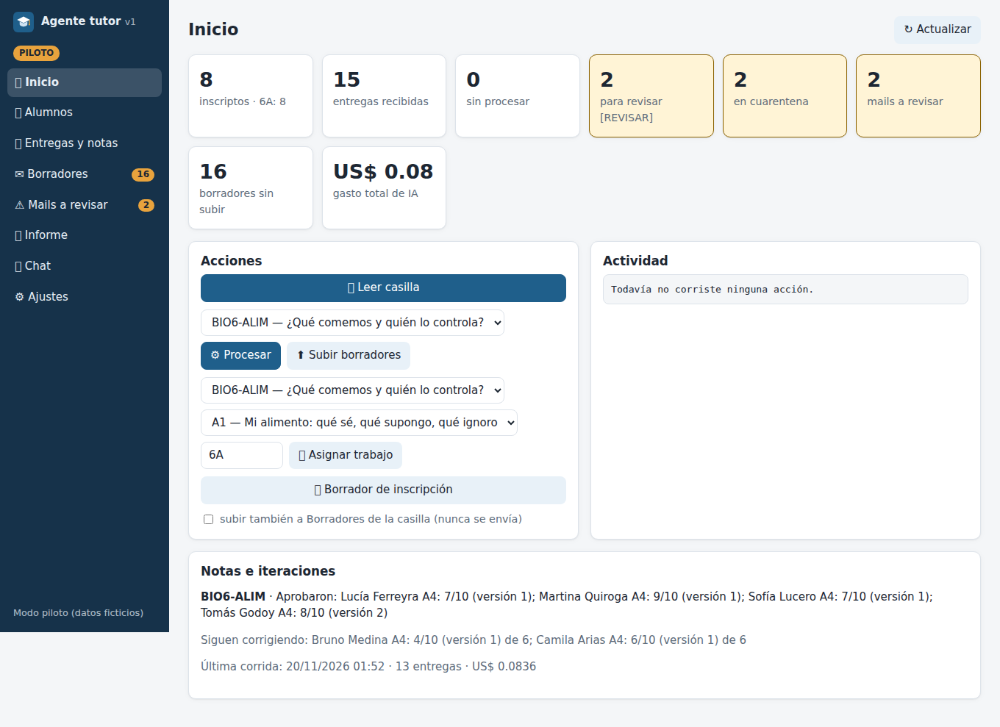

# Agente tutor

Seguimiento personalizado de cada alumno, entre clase y clase, **para cualquier materia**,
**todo por mail**: sin formularios, sin Drive, sin plataformas nuevas para los alumnos.
El docente da la clase teórica y fija los parámetros de evaluación; el sistema lee las entregas
que llegan a su casilla, las evalúa contra la rúbrica, pone una nota de 1 a 10, redacta una
devolución socrática y le informa al docente qué retomar. El alumno rehace el trabajo hasta aprobar.

## El circuito

1. **Inscripción (una vez, a principio de año).** El docente manda el mail de inscripción
   (`./tutor.sh inscripcion-borrador`); cada alumno responde desde su cuenta del colegio con nombre,
   apellido y curso.
2. **Clase y trabajo.** El docente da la clase y manda el trabajo por mail
   (`./tutor.sh asignar BIO6-ALIM A4 --curso 6A`): el asunto lleva el código `[BIO6-ALIM A4]`.
3. **Entrega.** El alumno responde ese mail con su trabajo: texto, fotos, PDF o audio, más dos
   líneas (`IA:` y `Autoevaluación:`).
4. **Devolución con nota.** `./tutor.sh procesar BIO6-ALIM` lee la casilla, evalúa y deja en
   Borradores, en el mismo hilo, la devolución con su nota. El docente la revisa y la manda.
5. **Iteración.** Si la nota es menor a 7, el alumno corrige y responde el mismo hilo; la nueva
   versión se evalúa reconociendo lo que mejoró. Con 7 o más, la actividad queda aprobada.

Proyecto Integrador Final — Diplomatura en IA para la Enseñanza y la Innovación Educativa (Universidad Austral).

## Principios

1. **El docente decide.** Todo lo que se evalúa sale de `unidades/<unidad>/unidad.md`, que escribe el docente. Si no está ahí, no se evalúa.
2. **La IA solo en el medio.** Leer y clasificar los mails, PDF, fotos y audios, llevar la base, calcular la nota, detectar quién no entregó, armar legajos, planilla, recordatorios y mails: **todo eso lo hacen scripts**. La IA (un modelo chico y barato) se usa únicamente para evaluar contra la rúbrica y redactar la devolución.
3. **Nunca da la respuesta.** La devolución sigue la escalera de la retroalimentación (aclarar → valorar → preguntar → sugerir) y un control automático marca cualquier devolución que copie la respuesta esperada.
4. **Nada sale sin el docente.** El sistema no envía mails: deja borradores que el docente revisa y manda. La casilla se lee en solo lectura.
5. **Datos mínimos.** Inscripción con nombre, apellido, mail y curso. Los datos de alumnos nunca van al repositorio.
6. **Seguro por diseño.** Solo cuentas del colegio, límites contra la inundación, tope de gasto y defensa en capas contra prompt injection. Ver [SECURITY.md](SECURITY.md).
7. **Cada docente usa su cuenta.** El mail se carga con `./tutor.sh configurar` y queda fuera del repositorio.

## Cómo funciona

```
Casilla del docente (IMAP, solo lectura) ──▶ buzon: clasifica cada mail                   (sin IA)
      inscripción → alumnos · entrega de un inscripto → entregas · resto → se ignora
                                                                           ▼
                adjuntos: PDF/docx → texto · fotos → OCR · audios → Whisper local   (sin IA)
                                                                           ▼
                lote: un paquete compacto por entrega (consigna, rúbrica, material de clase, entrega,
                      antecedentes y versión anterior si es una iteración)
                                                                           ▼
                router: plantilla (sin IA) · Haiku (lo normal) · Sonnet (lo difícil)
                agente tutor: evalúa por criterio + redacta la devolución → JSON
                                                                           ▼
                aplicar: valida, calcula la nota 1-10 y guarda                         (sin IA)
                pendientes: quién no entregó → recordatorio con plantilla               (sin IA)
                legajos + informe + planilla de notas + borradores en el hilo del alumno (sin IA)
```

Solo cuando una foto no tiene texto legible (un dibujo, letra manuscrita) se le pasa esa imagen reducida a la IA.

## Las capas de una IA propia

| # | Capa | Cómo está resuelta |
|---|---|---|
| 1 | **Prompt** | `.claude/agents/tutor.md`: rol, escalera de la retroalimentación, reglas, ejemplo resuelto y salida JSON. Cada llamada registra la versión (hash) del prompt. |
| 2 | **RAG** | `tutor/rag.py`: BM25 en Python puro sobre el material de la clase. A cada entrega le llegan los 3 fragmentos que vienen al caso, y la devolución manda al alumno a esa sección. |
| 3 | **Herramientas** | Mínimas a propósito: las herramientas son los scripts. La IA solo puede *leer* las imágenes que tiene que mirar. |
| 4 | **Accesos** | Solo cuentas del colegio (dominio y nómina). IA en modo restringido, sin conectores, confinada a una carpeta. Datos con permisos de solo dueño. |
| 5 | **Guardrails** | Detector de prompt injection, texto oculto en PDF, canario, validación de toda salida, control de fuga de la respuesta, [REVISAR], docente en el circuito. Ver [SECURITY.md](SECURITY.md). |
| 6 | **Caché** | Adjuntos por hash; evaluaciones reutilizadas si el mismo texto vuelve a llegar; la parte fija del prompt va primero y una sola vez por tanda. |
| 7 | **Router** | `tutor/router.py`: entregas mínimas → plantilla (0 tokens); lo normal → modelo rápido (Haiku); imágenes, sospechas o salidas inválidas → modelo fuerte (Sonnet). Modelos fijados por versión. |
| 8 | **Observabilidad** | Tabla `llamadas` (modelo, latencia, tokens, costo, reintentos, validaciones fallidas, versión del prompt) y `./tutor.sh metricas`. Calidad real: cuánto edita el docente cada borrador antes de enviarlo (`./tutor.sh calidad`). |
| 9 | **Evaluación contra el docente** | `evals/`: el docente corrige casos a mano y `./tutor.sh evaluar-agente` mide la coincidencia del agente, criterio por criterio. Es la única forma honesta de decir que el agente es "preciso". |
| + | **Retención de datos** | `./tutor.sh purgar --ciclo 2026 [--anonimizar]` al cerrar el ciclo. |

## Teorías de la diplomatura que aplica

| Marco | Dónde aparece |
|---|---|
| Enseñanza para la Comprensión (tópico generativo, metas, desempeños, valoración continua) | estructura de `unidad.md`; cada entrega es un desempeño valorado |
| Rúbricas de 4 niveles | `unidad.md` §5; el agente asigna nivel + evidencia textual por criterio |
| Escalera de la retroalimentación / feedback formativo | formato fijo de cada devolución |
| Discernimiento frente a la IA | criterio transversal C3 + señal de copia acrítica para el docente |
| Metacognición | autoevaluación obligatoria en cada entrega (criterio C4) |
| DUA | el alumno responde en texto, foto, PDF o audio |

## Uso

```bash
python3 -m venv venv && venv/bin/pip install -r requirements.txt
./tutor.sh configurar                     # primera vez: tu mail del colegio, dominio, contraseña de aplicación
./tutor.sh inscripcion-borrador --subir   # mail de inscripción a Borradores (lo mandás vos)
./tutor.sh sync                           # lee la casilla: inscripciones y entregas
./tutor.sh estado                         # inscriptos, mails a revisar, rechazos, cuarentena
./tutor.sh asignar BIO6-ALIM A4 --curso 6A --subir   # mail del trabajo a Borradores
./tutor.sh procesar BIO6-ALIM             # circuito completo → informe + planilla + .eml
./tutor.sh procesar BIO6-ALIM --subir     # además sube las devoluciones a Borradores (no envía)
./tutor.sh unidades                       # unidades cargadas
./tutor.sh liberar 12                     # saca la entrega #12 de cuarentena
./tutor.sh metricas                       # costo, latencia, router, calidad
./tutor.sh evaluar-agente                 # coincidencia con los niveles del docente (evals/casos.csv)
./tutor.sh purgar --ciclo 2026 --anonimizar --confirmar   # retención de datos
```

Para leer la casilla hace falta una **contraseña de aplicación** de Google (requiere la verificación
en 2 pasos; en cuentas de un colegio, que el administrador permita IMAP). `configurar` guarda tus datos en `config.toml` y `.env`, que están en `.gitignore`: tu mail nunca
llega al repositorio (antes de escribir lo verifica, y un test falla si aparece un mail real en un archivo versionado).

Requiere el CLI de Claude Code (`claude`); el prompt del agente está en `.claude/agents/tutor.md`. Para audios,
un python con `faster-whisper` (`audio_python` en `config.toml`).

### Probarlo sin casilla (piloto)

```bash
./tutor.sh --piloto --hoy 2026-11-20 procesar BIO6-ALIM
```
Lee los mails de `piloto/buzon/` en lugar de la casilla: 10 mails de inscripción (8 válidos, uno de
dominio ajeno y otro con alias, rechazados) más uno incompleto que queda para revisar; un mail de una
colega que se ignora; una consulta de una alumna que no corresponde a ninguna actividad; y 15 entregas
(una sin inscripción y un reenvío duplicado, que quedan en cuarentena; un intento de manipular la nota
y otro con texto oculto en un PDF, que quedan en [REVISAR]; una entrega mínima que se resuelve por
plantilla; y la **segunda versión** de un alumno después de la devolución), con un PDF, una foto de
etiqueta, un esquema dibujado y un audio. Las salidas quedan en `datos_piloto/`.

### Tests

```bash
venv/bin/pytest -q            # TUTOR_WHISPER_PY=/ruta/python para incluir el test de audio
```

## Cargar una unidad nueva

Copiar `plantillas/unidad.md` a `unidades/<materia>-<unidad>/unidad.md`, completar tópico, metas,
actividades (consigna, qué se espera ver, ideas erróneas frecuentes, criterios) y rúbrica, y dejar
el material de la clase en `clase.md`. El código de la unidad y de cada actividad va en el asunto de los mails.

## Panel web

`./tutor.sh panel` abre un panel para manejar todo sin terminal (`./tutor.sh --piloto panel` lo muestra con los datos ficticios):
- **Inicio:** estado (inscriptos, entregas sin procesar, [REVISAR], cuarentena, mails a revisar, gasto) y botones para leer la casilla, procesar, asignar un trabajo, armar la inscripción y subir borradores.
- **Alumnos** con su legajo, **Entregas y notas** (versiones y estado), **Borradores** (revisar y editar antes de subir), **Mails a revisar** (inscribir a mano o descartar), **Informe** y planilla.
- **Chat:** un asistente que contesta sobre el estado ("¿quién no entregó la A4?") y, si le pedís algo ("asigná la A4 a 6A"), te lo deja como botón. **No ejecuta nada solo y no tiene herramientas.**

Escucha solo en `127.0.0.1` y pide el token de `.env` (`TUTOR_PANEL_TOKEN`, lo genera el primer arranque). Para usarlo desde otra compu
se publica dentro de tu red de Tailscale (`deploy/tutor-panel.service` tiene los pasos). Opcionalmente, `[panel] panel_ips` limita las compus.



## Notas

Cada nivel de la rúbrica vale una nota (Inicial 4, En desarrollo 6, Logrado 8, Destacado 10, en
`[calificacion]`); la nota es el promedio de los criterios, redondeado, y la calcula un script.
Con `nota_aprobacion` (7) o más, la actividad queda aprobada. La planilla
`informes/calificaciones_<UNIDAD>.xlsx` tiene, por alumno y actividad, la última nota, cuántas
versiones mandó, la fecha y el estado.

## Estructura

```
tutor/
  cli.py            comandos (./tutor.sh …)
  configurar.py     asistente de primera vez (mail, dominio, IMAP → config.toml)
  config.py         configuración (config.toml)
  db.py             base SQLite
  buzon.py          lee la casilla (solo lectura) y clasifica cada mail
  sync.py           valida y guarda inscripciones y entregas
  seguridad.py      cuentas del colegio, anti-inundación, detector de prompt injection
  adjuntos.py       PDF, docx, fotos (OCR) y audios (Whisper), sin IA
  rag.py            búsqueda en el material de la clase (BM25)
  lote.py           arma el paquete de cada entrega
  router.py         plantilla / modelo rápido / modelo fuerte
  motor.py          caché → router → IA → validación
  ia.py             única puerta a la IA (modo restringido)
  aplicar.py        valida y guarda lo que devuelve la IA
  pendientes.py     quién no entregó + recordatorios
  informe.py        legajos e informe al docente
  correo.py         .eml y borradores IMAP: devoluciones, trabajo, inscripción (nunca envía)
  planilla.py       planilla de calificaciones (.xlsx)
  web/              panel web (servidor + front) y chat del asistente
  observabilidad.py métricas de uso, costo y calidad
  evals.py          evaluación del agente contra el docente
  unidades.py       lee unidad.md
.claude/agents/     el prompt del agente tutor (evalúa) y del asistente del panel (chat)
unidades/           una carpeta por unidad: unidad.md + clase.md
plantillas/         plantilla de unidad y formato de devolución
evals/              casos para que el docente corrija + resultados
piloto/             mails ficticios (buzon/*.eml) y ejemplos de salida
tests/              121 tests (sin IA)
SECURITY.md         amenazas y defensas
```
